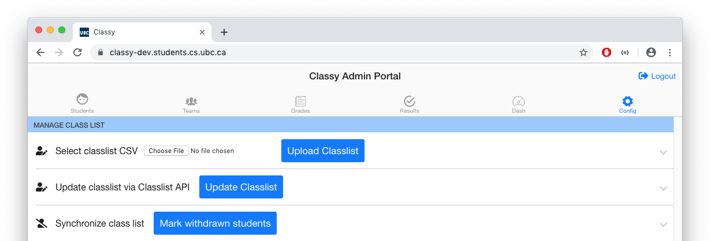
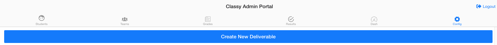
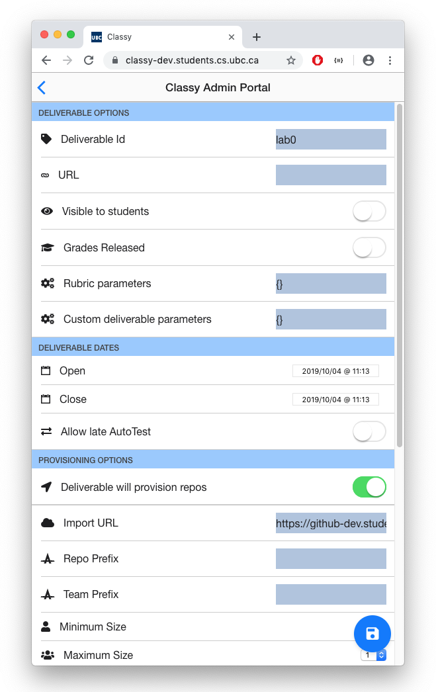
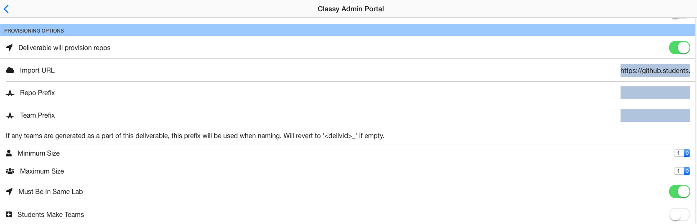

# Portal Manual

<!-- TOC depthfrom:2 -->
- [Portal Manual](#portal-manual)
  - [Overview](#overview)
  - [Classlist Enrollment](#classlist-enrollment)
  - [Handing Back Files](#handing-back-files)
  - [Deliverable Configuration](#deliverable-configuration)
  - [Distributing Assignments and Repository Creation](#distributing-assignments-and-repository-creation)
<!-- /TOC -->

## Overview

AutoTest configurations allow for the unique customization of course content. The configuration steps below give you basic introduction to steps for a typical course delivery. Click on the UI header of a configuration setting to see more detailed instructions.

## Classlist Enrollment

Classy is integrated with Classlist to access student enrollment information. An instructor must update the classlist enrollment before Classy receives any student enrollment information.

The **Admin Settings** view contains an **Update Classlist** button that automatically retrieves the current student information from Classlist. Add, update, and delete information will be viewable each time you click on **Update Classlist**.

If more customizable classlist updates are necessary, a CSV may be uploaded with a custom classlist by the instructor. To upload a custom CSV, you will need to add the `ACCT`, `SNUM`, `CWL`, `LAST`, `FIRST`, and `LAB` headers to the CSV to produce a format accepted by Classy.

## Handing Back Files

Course staff can hand files back to individual students through the portal: a marked midterm, a code review, anything one student (and only that student) should be able to download. Students see a **Handed Back Files** section on their portal page listing each file with the deliverable it belongs to; each student can only download their own files.

The **Hand Back Files** section of **Admin Settings** takes a deliverable and either:

- a **zip** of per-student files named by CSID, which is what a marking tool's per-student export looks like. `a1b2c.pdf`, `a1b2c_midterm.pdf` and `A1B2C-v2.pdf` all go to the student with CSID `a1b2c`. Files whose name matches no student are reported and not stored, so a zip can be fixed and uploaded again.
- a **single file** together with the student's CSID.

Uploading a file with the same name for the same student and deliverable replaces the earlier one. The list under the upload shows everything handed back for the selected deliverable, with a download link and a **remove** action for each file. Every upload and removal is recorded in the audit log.

Files are stored beside the AutoTest run output (`<persist dir>/handbacks/`), not inside it, so the cron job that archives old runs leaves them alone. They should be archived with the rest of the course data at the end of the term.

## Deliverable Configuration

A deliverable has many possible configurations that result in unique AutoTest behaviour, but most AutoTest behaviour is impossible without a deliverable. Creating a deliverable is *necessary* before one can:

- provision repositories to students
- receive AutoTest feedback on `commit` and `push` events
- store grade information in Classy and display it on the Admin Grade Dashboard

These prior three actions create the core scope of desirable AutoTest functionality. Hence, if you are learning how to use AutoTest and you are not sure where to start, always start by creating a deliverable. The **Admin Configuration Panel** will display the option of creating a deliverable:

The **Admin Configuration Panel** will display a list of all deliverables. Clicking on the deliverable will open up a list of configuration settings for the deliverable:

It is *mandatory* to include a `Deliverable Id` name. The `Deliverable Id` cannot be changed once it is created. All other configuration settings on the **Deliverable Configuration Panel** are *optional*.

## Distributing Assignments and Repository Creation

As AutoTest deals with sensitive student information, all repositories that are provisioned will be private. Only staff and admin roles have access to private repositories.

Repository Provisioning Pre-Requisites:

- [Classlist Enrollment](#classlist-enrollment)
- [Deliverable Creation/Configuration](#deliverable-configuration)

`Provisioning Options` *should* be considered before provisioning repositories. It is likely that an instructor will want to distribute starter code as boilerplate material for a student, as it will give the assignment a structure that helps integrate it with autograding functionality:

Once the pre-requisites have been met and your provisioning options have been configured, an option to **provision** and **release** repositories can be found under **Admin Configuration Panel** by clicking on **Manage Repositories**.

*Provisioning* repositories will create the GitHub repositories and place starter code in the assignment. Due to GitHub limitations, it takes approximately 5 seconds to distribute a repository. If your class has many students, you must leave enough time to provision the repositories (i.e. ~2 hours for a large class).

*Releasing* repositories gives a student or team access to read and write to their GitHub repositories. This action is much quicker than repository provisioning and will likely not take longer than 2 minutes for an entire class.

